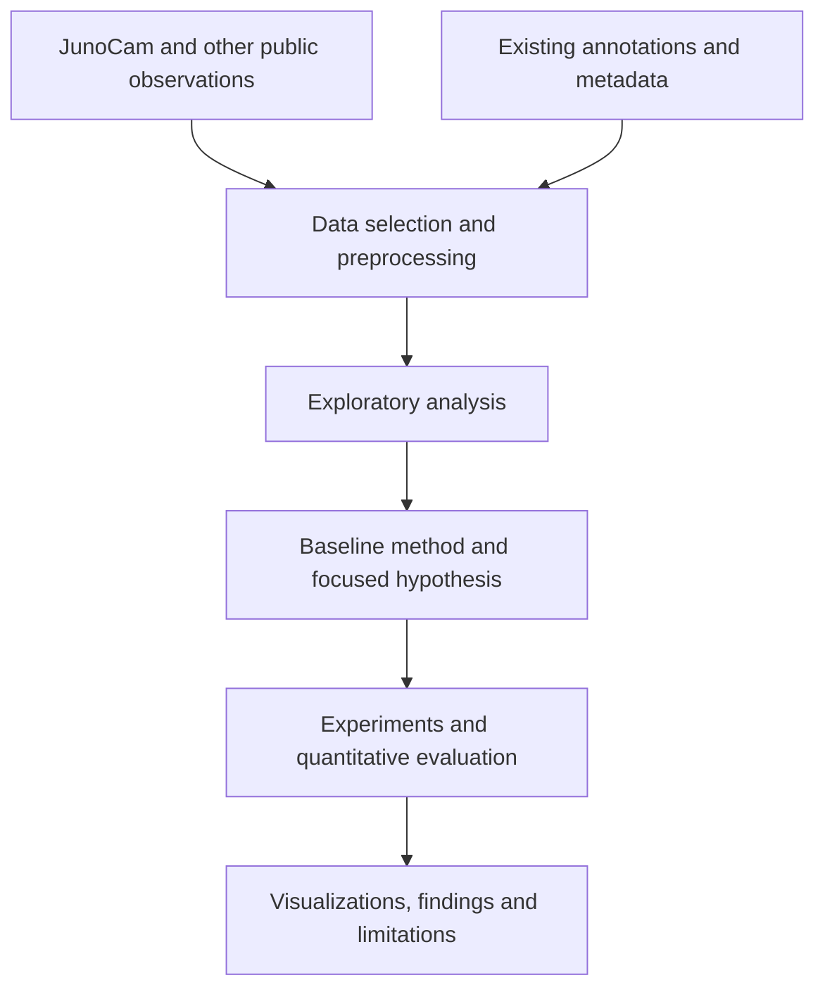

# 🪐 JOVIS

### Jupiter Vortex Intelligence

**AI-Assisted Analysis of Jupiter's Atmospheric Vortices**

*ROSPIN Satellite Data Processing Masterclass 2026 · Scientific Research Track*

---

## Overview

**JOVIS** is a research project exploring how artificial intelligence, computer vision, and publicly available spacecraft observations can help us study the **atmospheric vortices of Jupiter**.

Jupiter's atmosphere contains complex rotating storms and cloud structures that differ in size, shape, color, latitude, and surrounding atmospheric conditions. NASA's **Juno** mission provides detailed imagery of these features, while citizen-science projects have made annotated data available for research.

Our aim is to investigate data-driven methods for characterizing Jovian vortices and to identify a **focused, testable research question** through literature review, dataset exploration, and baseline experiments.

> **Project status:** Early-stage scientific research. The exact research question, model architecture, and novelty claim are **not yet finalized**. We are intentionally keeping the scope broad until our initial experiments establish a worthwhile direction.

## Research Motivation

Studying Jupiter's vortices can help researchers investigate how its atmosphere is organized and how its cloud features vary across regions and observations.

Analyzing large collections of spacecraft images presents several challenges:

- Vortices vary significantly in appearance, scale, shape, and contrast.
- Complex cloud bands and turbulent regions can resemble coherent vortices.
- Images from different spacecraft passes can vary in viewing geometry, illumination, and resolution.
- Image-based measurements and human annotations can be ambiguous.
- Reliable comparisons require careful handling of image metadata and validation.

**Our guiding question:**

> How can AI-assisted analysis of spacecraft imagery support more systematic and reliable characterization of Jupiter's atmospheric vortices?

We will refine this broad question into one precise, falsifiable hypothesis as the research progresses.

## Potential Research Directions

These are **possibilities under consideration**, not a list of features we have committed to implement:

| Direction | Research opportunity |
| --- | --- |
| Vortex detection | Identify and localize individual vortex-like structures in imagery. |
| Morphology analysis | Estimate apparent size, shape, orientation, color, and context. |
| Cross-observation robustness | Evaluate how methods generalize across different Juno close approaches (*perijoves*). |
| Measurement uncertainty | Investigate the reliability of automated estimates and ambiguous annotations. |
| Population analysis | Examine vortex properties and distributions, accounting for observational limitations. |
| Temporal analysis | Explore changes over time where appropriate repeated observations are available. |

A **perijove** is the point in Juno's orbit where the spacecraft is closest to Jupiter. The imagery acquired around different close approaches may have differing observation conditions, which matters when evaluating machine-learning methods.

## Data Sources

Our proposed work is based on open planetary-science resources:

| Source | What it provides | Link |
| --- | --- | --- |
| **NASA JunoCam** | Visible-light observations of Jupiter's clouds and atmospheric structures. | [JunoCam image archive](https://www.missionjuno.swri.edu/junocam/processing) |
| **Jovian Vortex Hunter catalogue** | Citizen-science-derived annotations and geometric properties for **7,222 catalogued vortices**. | [Zenodo](https://zenodo.org/records/11659728) |
| **Jovian Vortex Hunter image dataset** | Image crops and labels relevant to atmospheric-feature classification. | [Hugging Face](https://huggingface.co/datasets/ramanakumars/JovianVortexHunter) |
| **Hubble OPAL** | Repeat observations of Jupiter and other outer planets. | [MAST/OPAL](https://archive.stsci.edu/prepds/opal/) |
| **Hubble Oval BA dataset** | Processed observations of a long-lived Jovian vortex, potentially useful for temporal studies. | [Dryad](https://datadryad.org/dataset/doi:10.5061/dryad.4xgxd25qn) |

**Data preparation note:** Before training a geometry-prediction model, we must verify that vortex annotations correctly map to the associated source images and coordinate systems. Access to an archive does not automatically imply that its products are ready-to-train examples.

## Related Work

JOVIS builds on previous research rather than claiming to be the first application of machine learning to Jupiter:

1. **Sankar et al. (2024), “Jovian Vortex Hunter: A Citizen Science Project to Study Jupiter's Vortices.”**  
   Established a large annotated vortex catalogue and analyzed Jovian vortex properties.  
   [Paper](https://doi.org/10.3847/PSJ/ad6e75) · [Dataset](https://zenodo.org/records/11659728)

2. **Sankar et al. (2024), “Understanding Confusion: A Case Study of Training a Machine Model to Predict and Interpret Consensus From Volunteer Labels.”**  
   Used a convolutional variational autoencoder (**cVAE**) to learn representations of Jovian atmospheric image features and study classification disagreement. This is related prior ML work, **not** an instance-level vortex-geometry detector.  
   [Paper](https://doi.org/10.5334/cstp.731) · [Code](https://github.com/ramanakumars/cvae)

3. **Biagiotti et al. (2025), “Machine Learning Spectral Clustering Techniques: Application to Jovian Clouds from Juno/JIRAM and JWST/NIRSpec.”**  
   Explored machine-learning-based analysis of Jovian cloud spectral observations.  
   [Paper](https://doi.org/10.1051/0004-6361/202554552)

**Novelty policy:** We will make no claim that a proposed architecture, detection task, or scientific finding is unprecedented without comparing it against the most directly relevant published methods and testing it empirically.

## Proposed Research Workflow

The precise model will depend on the selected research problem. Candidate approaches include conventional image processing, CNN-based models, object detection, segmentation, representation learning, and uncertainty-aware prediction. We will begin with **reproducible baselines**, rather than assume that a more complex architecture is automatically better.

### Evaluation principles

- Compare any proposed method against appropriate existing baselines.
- Keep related observations grouped to avoid train/test data leakage.
- Test generalization across distinct observations when relevant.
- Report both quantitative performance and failure cases.
- Separate visible cloud morphology from claims about underlying atmospheric dynamics.
- Clearly distinguish new scientific observations from unverified candidate patterns.

## Technology Stack (Planned)

- **Language:** Python
- **Machine learning:** PyTorch
- **Image processing:** OpenCV, Pillow
- **Scientific computing:** NumPy, pandas, SciPy
- **Visualization:** Matplotlib and/or Plotly
- **Development:** Git and GitHub; Jupyter notebooks for exploration

The exact dependencies and installation instructions will be added when the implementation is established.

## Development Roadmap

| Phase | Dates (2026) | Intended outcome |
| --- | --- | --- |
| 1. Literature and data exploration | **Nov 7–13** | Review closest papers, inspect datasets, and narrow the research question. |
| 2. Data pipeline | **Nov 14–20** | Establish reproducible data preparation and initial exploratory analysis. |
| 3. Baseline experiments | **Nov 21–27** | Implement and evaluate an appropriate baseline. |
| 4. Research experiments | **Nov 28–Dec 4** | Test the chosen hypothesis, run comparisons, and analyze limitations. |
| 5. Final results | **Dec 5–11** | Prepare results, documentation, visualizations, and ROSPIN submission. |

**Target submission:** December 11, 2026.

## Possible Applications Beyond Jupiter

Although our research focuses on Jovian atmospheric imagery, some of the **computer-vision and measurement techniques** could potentially be adapted to other atmospheric imagery, including observations of **cyclones on Earth**.

This is a **possible future methodological application**, not a claim that a Jupiter-trained model can predict Earth's weather. Terrestrial cyclones and Jovian vortices differ in their physical environments, so transfer would require separate data, training, and validation.

## Team

**Team Bile** · ROSPIN 2026, Scientific Research Track

- **Darius Oproiu** — Babeș-Bolyai University
- **Rareș Cotfas** — Babeș-Bolyai University
- **Bogdan Știube** — Technical University of Cluj-Napoca

## Project Status and Reproducibility

This repository currently documents the **research concept and planned workflow**. As the project develops, we intend to add reproducible code, dataset preparation instructions, experiment configurations, results, and supporting documentation.

No final architecture, numerical performance result, or confirmed novel finding is claimed in this README.

## Data and Attribution

The datasets and papers linked above are maintained by their respective authors and institutions. Follow each source's license, citation, and usage requirements when using images, annotations, code, or derived products.

---

**JOVIS · Exploring Jupiter's atmosphere through data and intelligent analysis**

