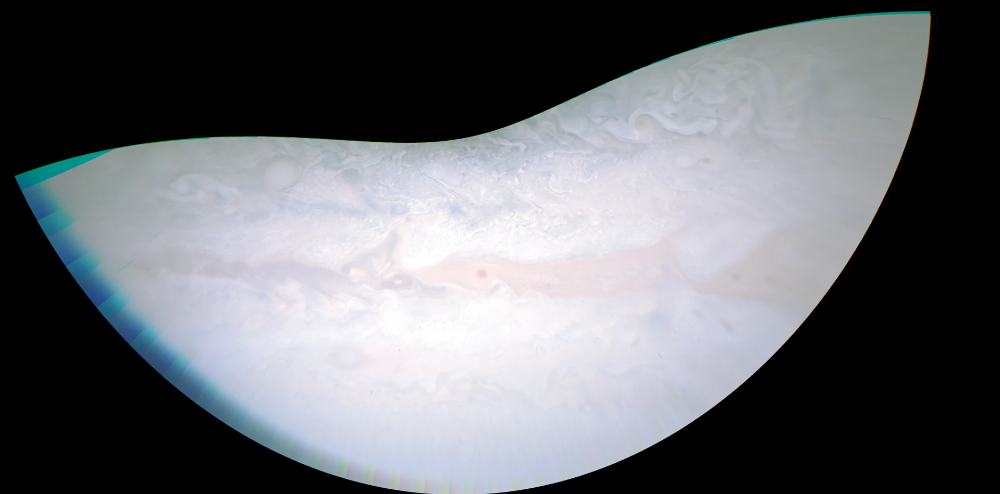
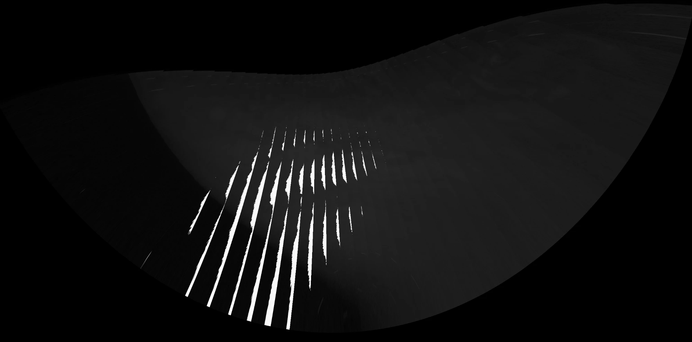
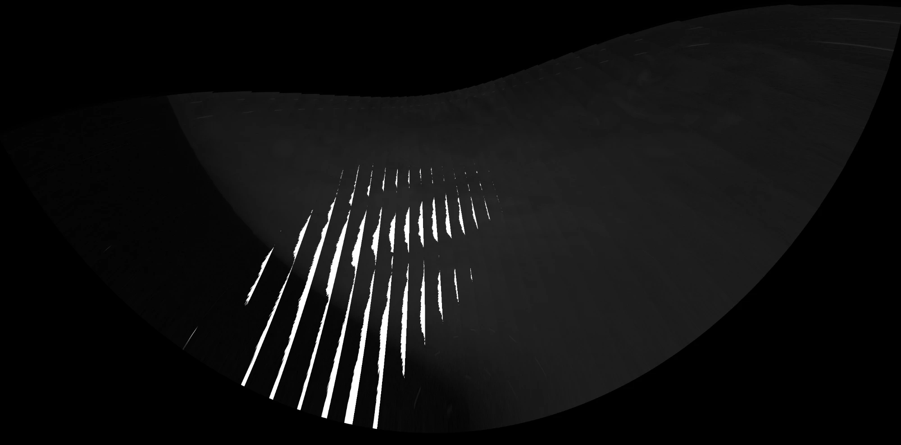
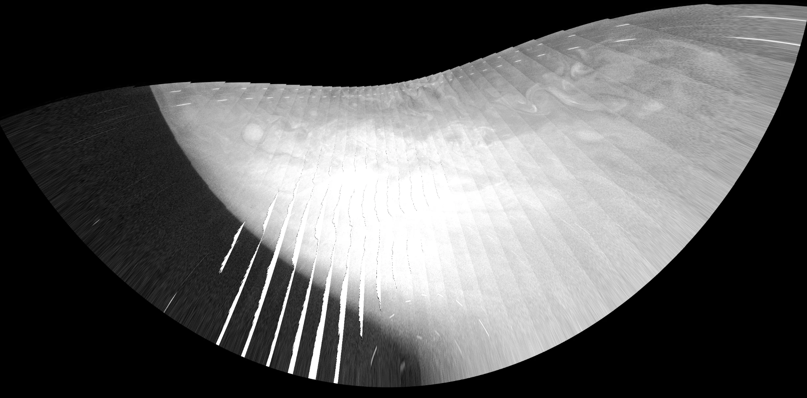
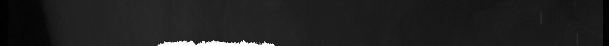
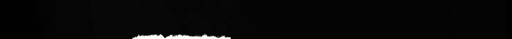
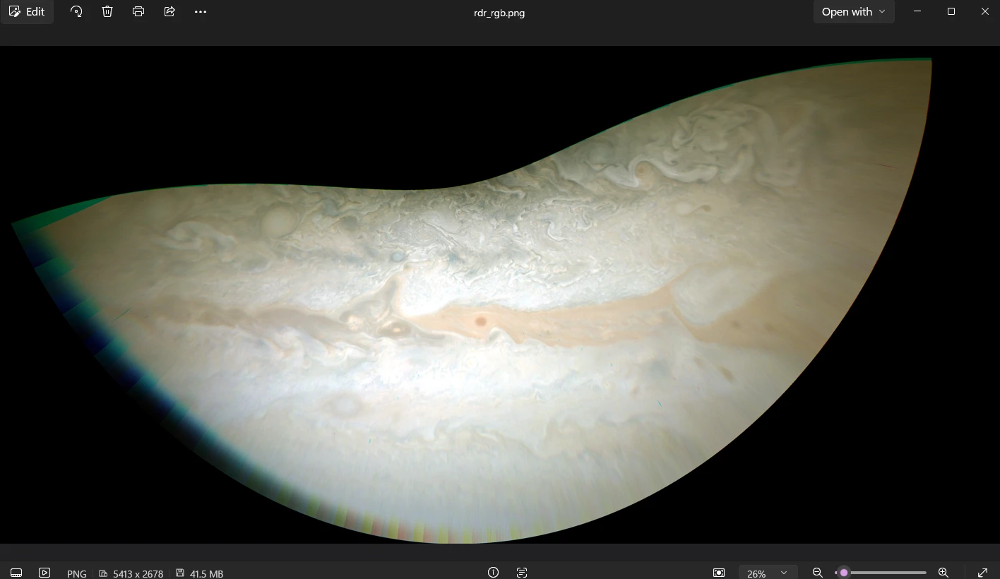
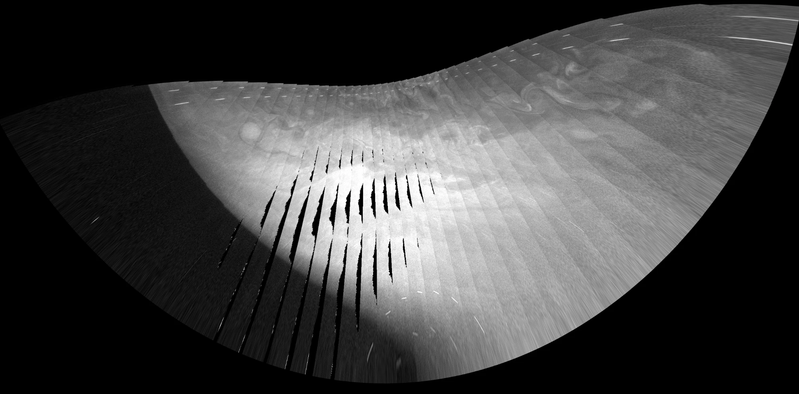

# Lining up JunoCam colour and methane images: the first test (PJ27)

*Written 18 Nov 2026. This is a step-by-step record of the first attempt to build one matched pair of RGB and methane images. It is written so that anyone in the team can follow it, even without having been there. It continues from [`methane_idea_findings.md`](methane_idea_findings.md). It ends with the results, what still needs fixing, and how to continue.*

---

## 1. What we are trying to do

JunoCam takes colour photos (red, green, blue) **and** separate photos through a **methane filter** (889 nm, near-infrared). Methane gas absorbs this light, so in a methane photo **high clouds look bright and deep clouds look dark**. That makes methane photos a rough "cloud height" signal.

NASA publishes both kinds of photo, but **not lined up with each other**. The methane photo and the colour photo of the same area were taken tens of seconds apart from a fast, spinning spacecraft, so pixel (100, 200) in one is not the same spot on Jupiter as pixel (100, 200) in the other. Our job is to put both photos onto **the same map of Jupiter**, so that every pixel matches. A collection of such matched pairs is the dataset.

Before doing this for hundreds of pairs, we test it on **one pair** to see whether the method works at all. This document is that test.

> **In a hurry? The essential pipeline is short.** Most of this document explains *why* and records the dead ends (the first run on raw EDR files, the stripe investigation). The commands that actually matter, in the right order, are collected in **section 9, "How to reproduce this test"**:
> 1. download the RDR pair → 2. `junocam2isis` (import, cut into strips) → 3. `spiceinit … web=yes` (attach position) → 4. `specpix` (mark saturated methane pixels as no-data) → 5. `mosrange` (one shared map grid) → 6. `cam2map` (put each strip on the grid) → 7. `automos` (glue strips into one map per filter) → 8. `isis2std` (export pictures).
>
> **Status:** the methane and colour maps line up **by eye**; this has **not been measured yet**. The first next step is a Python script that measures it (section 9).

---

## 2. The data: what exists, what is usable, what we will use

### 2.1 Where everything comes from

All numbers below come from NASA's own index tables. Every JunoCam data volume on the NASA archive (the PDS, Planetary Data System) has an `INDEX.TAB` listing every image with its orbit, filter, target (Jupiter, Io, Europa…), description and spacecraft position. We downloaded these tables for all volumes and saved them as `teste/junocam_image_index.csv`.

| What | Count |
|---|---|
| All JunoCam images in the archive (orbits 0–80) | 42,166 |
| … of Jupiter (not moons, not stars) | 41,339 |
| … taken through the **methane** filter | ~10,300 (10,330 index rows; a few are repeated versions of the same image) |
| … methane images in orbits 13–36 | 755 |
| … methane **close-ups** in orbits 13–36 | **101** |
| … methane **close-ups** in all orbits | **312** (35 in orbits 0–12, 101 in 13–36, 176 in 37–80) |

An **orbit** is one loop of Juno around Jupiter; each loop has one closest approach, called a **perijove (PJ)**. "Orbit 27" and "PJ27" mean the same thing. A typical orbit has ~190 Jupiter images, of which ~20–30 are methane, and only a handful are close-ups. A few orbits have thousands of images because the camera shot long "movies".

**Whole-planet images vs close-ups.** All images come from the same camera and are taken the same way; what differs is how far Juno was from Jupiter:

| | Far away (most images) | Close-up (under 60,000 km) |
|---|---|---|
| What's in the photo | The whole planet, often with black space around it | Only a portion of the planet |
| Detail | One pixel = hundreds of km | One pixel = ~5–40 km |
| When | Approaching or leaving Jupiter, often long "movies" | The few hours around closest approach |

"Close-up" is our own label, not a NASA category (see 2.2). Images also differ by **filter** (colour `C`, methane `M`), **target** (Jupiter, moons, stars for calibration) and **processing level** (raw `EDR`, calibrated `RDR`, NASA's global maps `H`/`P`).

### 2.2 How the ~300 close-up pairs were selected

Each candidate pair had to pass three filters:

1. **It is a methane image of Jupiter** (`filter = M`, `target = JUPITER` in the index). Methane is always a separate photo; there are no images that contain methane and RGB together.
2. **It was taken close to Jupiter: under 60,000 km altitude.** JunoCam pixels cover ~0.67 milliradians, so at 60,000 km one pixel is ~40 km on Jupiter, and at 8,700 km (our test pair) it's ~6–8 km. Further away, storms become only a few pixels wide. 60,000 km is our own cut-off, chosen to keep detail; it is not a NASA category.
3. **It has an RGB partner**: the nearest colour photo in time. For the 101 close-ups in orbits 13–36, every one has a partner, taken **19 to 152 seconds** apart (median 90 s).

This gives **101 pairs in orbits 13–36** and **312 across the whole mission**. That is where "~300 pairs" comes from. The 101 pairs (with download paths to their RDR files) are saved in `teste/methane_closeups/closeup_methane_13_36.csv`.

**Where the close-ups point:** of the 101 in orbits 13–36, **72 are over the far north (above 50°N)**, 24 at mid-latitudes and 5 in the far south. So the dataset will be **mostly northern polar**. That has to be stated as a limitation.

### 2.3 How much of it is actually good

Not every pair will be usable. What we know so far:

- **Four close-up pairs were inspected by eye** (in `teste/methane_closeups/`):

  | Pair | Quality |
  |---|---|
  | PJ27 polar cyclones (`27M00014`) | good |
  | PJ27 Jet N5 (`27M00022` + `27C00023`) | mostly good, **our test pair** |
  | PJ21 Great Red Spot | half of it saturated (too bright) |
  | PJ13 hot spot | unusable |

  Two out of four is far too small a sample to give a percentage. A realistic expectation is "somewhere around half", but **this has not been measured**.
- **Methane images need long exposures** (100–200 ms, against ~3 ms for colour), so they are prone to saturation and noise. Some were also stored with lossy compression.
- **Radiation damage:** from orbit 47 the camera was slowly damaged by Jupiter's radiation (more noise and stripes) and was nearly unusable by orbit 56. In late 2023 the team heated the camera and it mostly recovered; the damage returned from orbit 74. Those orbits contain ~1,900 methane images (orbits 47–56) and ~20 (74+). They are **not unusable as a block**: early in the damaged period many images are fine. But they need checking one by one.
- **The test pair itself** turned out to have saturated pixels along one edge of every methane strip (section 6 and 7). That is fixable, but it means every pair needs an automatic quality check.

### 2.4 What we will use, and what we won't

**Used:**
- **The RDR files** (calibrated) for both methane and colour. RDR is NASA's processed version: 16-bit pixels on a brightness scale where 10,000 = a perfectly white surface. The **EDR** files are the raw camera output (8-bit, not corrected); they were only used in the first test run, by mistake (see section 5).
- **First: the 101 close-up pairs from orbits 13–36.** These are the orbits covered by the Jovian Vortex Hunter labels (the Zooniverse project in our HuggingFace/Zenodo data, which we checked in `teste/test.ipynb`). Using the same orbits means the methane dataset can later be linked to those vortex labels. They are also before the radiation damage.
- **Then, if the method works: close-ups from other good orbits** (0–12, 37–46, 57–73), up to the 312 total, minus whatever fails the quality check.
- **Optionally: distant (non-close-up) pairs** as a coarser, lower-detail extra set. There are thousands, but each pixel covers much more of Jupiter.

**Not used:**
- **NASA's ready-made "global methane maps"** (filter code `H`, 71 orbits). We checked them: about 78 km per pixel, only ~26 % of the planet covered, built from just two images each, and only ~20 distinct grey levels (very coarse brightness steps). Too crude.
- **The JunoCam website gallery images** (JPG/PNG). They are processed for looks, 8-bit, without calibration or geometry.
- **The 10 "all four filters" images** (filter code `A`). None of them show Jupiter.
- **Images of moons.**
- **Radiation-damaged orbits**, at least at first.

### 2.5 Why we test on one pair first

Building the dataset means the same chain of steps for every pair: download, import, attach position, project onto a map, glue strips, check quality, cut out the overlap. If any step doesn't work, or the two images don't line up, all the work on 300 pairs is wasted. So the first goal is a **go/no-go test on one pair**: do the methane and colour maps land on top of each other?

The test pair is **PJ27 `27M00022` (methane) + `27C00023` (colour)**. The numbers are just the images' place in orbit 27's sequence (22nd and 23rd); the colour photo was taken 60 s after the methane one. It was chosen because it was one of the two clean pairs we had inspected: both images show the same area (the "Jet N5" jet stream, ~51°N) from close (~8,700 km), without the saturation of the Great Red Spot pair or the noise of the hot-spot pair.

Where these facts come from:
- **Image names, the "PJ27 Jet N5" description, the 51°N latitude and the ~8,700 km altitude:** NASA's index table for volume `JNOJNC_0015` (`INDEX.TAB`). Our close-up list `teste/methane_closeups/closeup_methane_13_36.csv` copies these values: description "PJ27 Jet N5", `alt_km` = 8,694.7, `sclat` = 51.09°. The colour partner `27C00023` was picked automatically as the nearest colour image in time.
- **The 60 s gap:** the `gap_s` column of the same list (60.3 s), i.e. the difference between the two images' start times in the index.
- **"Clean", compared with the other pairs:** our own by-eye inspection of the four close-up pairs, done before this test and described in [`methane_idea_findings.md`](methane_idea_findings.md). The side-by-side images are in `teste/methane_closeups/` (this pair: `rgb_vs_methane_jetn5_27.png`).
- **Confirmed during the test:** `campt` on a methane strip gave a spacecraft altitude of 8,711 km and a time of 2020-06-02 10:10 UTC, matching the index (section 5, step 3).

### 2.6 What the final dataset will look like, and how big it can get

**One dataset sample = one matched pair**, produced by the pipeline in this document:
- the **colour map** (red, green, blue) and the **methane map**, cut to the rectangle where all four filters overlap, on the same latitude/longitude grid, so pixel (x, y) is the same spot on Jupiter in all four layers;
- a **valid-pixel mask** marking where data is missing or bad (saturated pixels, glow, specks, edges);
- **metadata:** orbit, image names, time gap between the two photos, lat/lon box, km per pixel.

For training, each sample can later be cut into smaller tiles. That is not decided yet.

**How many samples can we get?** Honest status today:

| | Pairs | Status |
|---|---|---|
| **For sure** | **1** (PJ27 Jet N5) | Processed; lines up by eye, not yet measured |
| **Likely** | Part of the **101** close-ups in orbits 13–36 | List ready. Usable fraction unknown: of 4 inspected, 2 were clean, so very roughly half, **not measured** |
| **Maybe** | Part of the other **211** close-ups (35 in orbits 0–12, 176 in 37–80) | No list built yet. Those in radiation-damaged orbits (47–56, 74+) need checking one by one |
| **Maybe, lower detail** | Thousands of far-away (whole-planet) pairs | Not planned yet; much coarser pixels (hundreds of km) |
| **Surely not** | NASA global maps, moon images, the 10 "A" images, methane images without a colour photo close in time, pairs that are mostly saturated or noisy (like the PJ13 hot spot) | Excluded |

So the realistic target for the main (close-up) dataset is **somewhere between a few dozen and ~300 pairs**, mostly over the far north. We will only know the real number after running the pipeline and the quality checks on the 101 pairs of orbits 13–36.

**Is that enough for machine learning?** It depends on what we count and what we want to do:
- **More than it sounds:** one pair is not one example. Each pair is a whole map (PJ27: ~6,900 × 2,700 pixels). For pixel-level tasks (e.g. predicting methane brightness from colour) even a few dozen pairs give millions of pixel examples. Cut into 128 × 128 tiles, each pair gives hundreds of patches.
- **Less than it sounds:** tiles from the same pair or orbit are very similar, so the real number of independent examples is closer to the number of **orbits** (~23 in orbits 13–36). Testing must use orbits the model never saw, which leaves only a few orbits for testing, so results will be uncertain. And the data is mostly far north.

| Enough for | Not enough for |
|---|---|
| Statistics: how methane relates to colour; how labelled vortices look in methane | Large models trained from scratch |
| Simple models and a small U-Net, with an orbit-based train/test split | Strong claims about the whole planet |
| A careful, honest small-scale study | Results that reliably generalise |

Adding the thousands of far-away pairs as a coarser extra set, or starting from a pretrained model, would help.

---

## 3. Background needed to follow the steps

### 3.1 Calibration and projection are two different things

| | **Calibration** (brightness) | **Projection / alignment** (position) |
|---|---|---|
| What it fixes | *How bright* each pixel is | *Where on Jupiter* each pixel is |
| Example | remove camera noise, undo compression, convert camera numbers to real light amounts | work out that pixel (100, 200) = latitude 41.5°, longitude 32° |
| Done by NASA already? | **Yes**, in the RDR files | **No** |
| Tool | – | ISIS + SPICE |

Projection is **not cropping**. Using the spacecraft's exact position and pointing at the moment of each photo, the software calculates where on Jupiter every pixel lands and "paints" it onto a flat map. If both photos are painted onto **the same map grid**, the same pixel finally means the same spot on Jupiter. ISIS can be treated as a black box ("raw file + position data in, map out"), as long as you know that it moves pixels to their true positions.

- **SPICE** is the *data*: NASA's record of where Juno was and which way it pointed, at every millisecond.
- **ISIS** is the *tool* (made by the US Geological Survey) that uses SPICE to do the projection.

### 3.2 Strips (framelets)

JunoCam doesn't take one big photo. As Juno spins (about twice a minute), the camera snaps a thin **strip** (also called a framelet) every fraction of a second, each a bit further along, like scanning a page line by line. A strip is 1,648 × 128 pixels. About 40 strips per filter make one full image. Each strip was taken at a slightly different moment from a slightly different place, so each needs its own position. That's why the software first cuts every image back into its strips.

### 3.3 The area covered

The map *grid* is for the whole planet, but only the patch the photos actually saw gets filled in. For a close-up, that's one region (here around 20–53°N). It's not a random square: the mission team planned where the camera looked. Its shape is irregular and curved, because Jupiter is a ball seen at an angle. The final dataset sample is the **rectangle (in latitude/longitude) where the methane and colour maps overlap**.

### 3.4 Where this fits in the literature

The link "bright in methane = high cloud" is old and well known. The most recent study (Fletcher et al., 2026) put JunoCam colour and methane images side by side and **described** what they saw ("this storm is bright in methane, so its clouds are high"). That is **qualitative**: words, not numbers. They did not line the images up pixel by pixel with software, and they name a measured, **quantitative** study (numbers over millions of matched pixels) as future work. No pixel-aligned JunoCam colour + methane dataset has been published, to our knowledge. That is the gap.

The tools to do it have existed for years. It hasn't been done because nobody needed it rather than because it's impossible:
- scientists study methane with better telescopes (Hubble, JWST);
- JunoCam is mainly an outreach camera;
- the methane images are few, dim and noisy;
- the processing is tedious;
- amateur processors make pictures, not datasets.

What the team does with the dataset afterwards is still open. Options discussed:
- Darius's original idea: RGB + methane as two inputs for vortex analysis.
- The dataset itself as the contribution.
- Predicting methane brightness from RGB. This was a suggestion during the literature review, not a team decision.

---

## 4. Setting up the computer

ISIS (the projection software, made by the US Geological Survey) only runs on Linux/Mac. On Windows we use **WSL**: a real Ubuntu Linux running inside Windows. It was already installed and running on this PC (with ~940 GB free).

**Ubuntu sees Windows files:** `C:\Users\rares\Desktop\Rospin` is `/mnt/c/Users/rares/Desktop/Rospin` inside Ubuntu (a bit slower, fine for small files). Windows sees Ubuntu files at `\\wsl$\Ubuntu\home\rares\` in File Explorer.

**Pasting in the Ubuntu window:** right-click or Ctrl+Shift+V.

### 4.1 Miniforge (conda)

**What conda is:** a program that installs other programs **and everything they depend on**, into separate "boxes" called **environments**. ISIS needs hundreds of libraries at exact versions; conda installs them all in one command, inside a box that doesn't touch the rest of the system. The prompt shows which box you're in: `(base)` is the default, `(isis)` is ours.

```bash
curl -L -O "https://github.com/conda-forge/miniforge/releases/latest/download/Miniforge3-Linux-x86_64.sh"   # download the installer
bash Miniforge3-Linux-x86_64.sh        # run it: Enter, read licence, type "yes", Enter for default folder, "yes" to initialise
~/miniforge3/bin/conda init zsh        # this Ubuntu uses the zsh shell, which the installer doesn't set up by itself
```
Then close and reopen Ubuntu; the prompt starts with `(base)`.

*Note:* the long capital-letter text during install ("THIS SOFTWARE IS PROVIDED AS IS…") is the standard licence disclaimer, not a warning.

### 4.2 ISIS

```bash
conda create -n isis -y                                   # make an empty box called "isis"
conda activate isis                                       # step into it
conda config --env --add channels conda-forge             # "channels" = online shops conda downloads from
conda config --env --add channels usgs-astrogeology       # the USGS shop, which has ISIS
conda install -c usgs-astrogeology isis -y                # install ISIS + everything it needs (~1.1 GB, 10–30 min)
python $CONDA_PREFIX/scripts/isisVarInit.py --data-dir=$HOME/isisdata   # tell ISIS where its program and data folders are
conda deactivate && conda activate isis                   # re-enter the box so the settings take effect
which junocam2isis                                        # check: prints a path if ISIS is installed
```
Installed version: **ISIS 10.0.0**. Messages about "Open MPI / CUDA" and "conda-pypi" during install are harmless notices.

### 4.3 ISIS support files

The first real command failed with *"Unable to load leapsecond file"*. ISIS needs small support files: e.g. a **leap-second table** (the extra seconds added to clocks over the years, needed to convert Juno's clock into real time). The full Juno data area is hundreds of GB, so we downloaded only what's needed:

```bash
downloadIsisData base $ISISDATA --include="kernels/**"                     # general files: leap seconds, planet sizes/positions
downloadIsisData juno $ISISDATA --include="kernels/{sclk,ik,iak,fk}/**"    # Juno: clock, camera description, mounting frames
```
Result: **6.6 GB** in total (the general planet-position tables were bigger than first estimated). The "ERROR … --track-renames" lines are harmless notes from the download tool; everything transferred 100 %.

**Trick that saves a lot of space:** Juno's position and pointing files (the big part of SPICE) are **not** downloaded. `spiceinit web=yes` (below) fetches them from a USGS web service, one image at a time.

---

## 5. The pipeline, step by step (first run, on EDR files)

Everything happens in the Ubuntu folder `~/jovis_pilot`.

> **Change from plan that should have been flagged at the time:** the first run used **EDR** (raw) files, not the **RDR** (calibrated) files we had agreed on. The reason was that the ISIS import tool is documented for EDR and it wasn't certain it accepts RDR. This was not said explicitly when the download commands were given. It does not affect the alignment test (position doesn't depend on brightness calibration), but it does affect brightness. RDR was tested afterwards (section 7) and works.

### Step 1: download the pair (EDR)

```bash
B=https://planetarydata.jpl.nasa.gov/img/data/juno/JNOJNC_0015/DATA/EDR/JUPITER/ORBIT_27
for f in JNCE_2020154_27M00022_V01 JNCE_2020154_27C00023_V01; do curl -fO $B/$f.LBL; curl -fO $B/$f.IMG; done
```
Each image has a `.LBL` (text description: time, filter, exposure) and an `.IMG` (pixels). Methane: 8 MB, colour: 25 MB.

### Step 2: convert to ISIS format and cut into strips (`junocam2isis`)

```bash
junocam2isis from=JNCE_2020154_27M00022_V01.LBL to=methane.cub
junocam2isis from=JNCE_2020154_27C00023_V01.LBL to=rgb.cub
```
**What it does:** reads NASA's format, writes ISIS's format (`.cub`), cuts each photo into its strips and labels each with filter and exact time. It does **not** add position.
**Result:** 171 files: ~40 methane strips (`methane_METHANE_0001.cub`…), ~40 each of red, green, blue (`rgb_RED_…` etc.), plus `.lis` files, which are simple lists of file names used to run a command on all strips at once.

The "Detected locale C … UTF-8" lines that every ISIS command prints are a harmless notice.

### Step 3: attach position and pointing (`spiceinit`)

```bash
spiceinit from=methane_METHANE_0001.cub web=yes                      # test one strip first (optional so you see the error after 1 strip instead of 40)
spiceinit -batchlist=methane_METHANE.lis from='$1' web=yes           # then all strips in each list
spiceinit -batchlist=rgb_RED.lis   from='$1' web=yes
spiceinit -batchlist=rgb_GREEN.lis from='$1' web=yes
spiceinit -batchlist=rgb_BLUE.lis  from='$1' web=yes
```
**What it does:** for each strip, looks up **where Juno was and which way the camera pointed** at that exact moment (SPICE data) and writes it into the strip, like a sticker. The picture itself is unchanged. `-batchlist` + `'$1'` = "run once per name in the list".
**Result:** no errors; every strip reports `InstrumentPositionQuality = Reconstructed`, meaning the **final, measured** trajectory was used (best quality). It took a few minutes (one web request per strip).

**Check with `campt`** (reports what's at the centre of a strip):

```bash
campt from=methane_METHANE_0020.cub
```

| Value | Meaning | Agrees with NASA's index? |
|---|---|---|
| Latitude 41.5°, longitude 328°W | centre of this strip on Jupiter | ✅ (index: spacecraft over ~51°N, 327°W; camera looks a bit south) |
| Spacecraft altitude 8,711 km | height above the clouds | ✅ (index: 8,695 km) |
| Resolution 7.7 km/pixel | size of one pixel on Jupiter | much sharper than NASA's global maps (78 km/pixel) |

### Step 4: choose one shared map grid (`mosrange`)

```bash
ls *_0*.cub > all.lis
mosrange fromlist=all.lis to=jupiter.map projection=Equirectangular onerror=continue londom=180
```
**What it does:** looks at all strips (methane and colour together) and writes `jupiter.map`, a description of **one map grid** (which lat/lon box, what pixel size). Using one grid for both filters is what makes their pixels line up. It creates no image.

Two problems on the way:
1. **13 strips failed** with *"Angle cannot be a non-Null special pixel"*. These are strips at the start/end of the photos that saw **only black space**; space has no latitude/longitude. `onerror=continue` skips them. This error reappears in later steps for the same 13 strips and is expected.
2. **The box came out as the whole planet (longitude 0–360°).** The patch sits around 32°E and crosses the 0° line, so ISIS covered everything. `londom=180` makes longitude count from −180 to +180 instead, so 0° is no longer an edge.

**Final grid:** latitude **20°N to 53°N**, longitude **−8° to 76°E**, **15 km per pixel** (the average over all strips; strip edges are blurrier than centres), about 6,900 × 2,700 pixels.

### Step 5: put every strip on the map (`cam2map`)

```bash
for f in $(cat all.lis); do cam2map from=$f to=map_$f map=jupiter.map pixres=map defaultrange=map; done
```
**What it does:** for each strip, calculates the lat/lon of every pixel and places it on the shared grid. `cam2map` can only handle one strip at a time, so each strip gets its own projected file (`map_…cub`).
**Result:** 147 strips projected (160 minus the 13 space-only ones).
**Why it was slow (30–60 min, ~10 GB):** `defaultrange=map` makes every strip's file the size of the **whole** map, even though each strip only covers a thin slice. This is a known inefficiency of how the command was set up; the result is correct. For many pairs a faster version will be needed.

Making every strip's file full-map-size was **not actually necessary**. The faster way is `defaultrange=camera` instead of `defaultrange=map`: each strip is projected only over the small area it actually covers, still using the same `jupiter.map` (same projection and pixel size), and `automos` then places all the small pieces on the shared grid when gluing. This should be much faster and use far less disk. It has **not been tested yet**; when trying it, check that the methane and colour maps still line up exactly.

### Step 6: glue the strips into one image per filter (`automos`)

```bash
ls map_methane_*.cub   > m.lis; automos fromlist=m.lis mosaic=methane_map.cub
ls map_rgb_RED_*.cub   > r.lis; automos fromlist=r.lis mosaic=red_map.cub
ls map_rgb_GREEN_*.cub > g.lis; automos fromlist=g.lis mosaic=green_map.cub
ls map_rgb_BLUE_*.cub  > b.lis; automos fromlist=b.lis mosaic=blue_map.cub
```
**What it does:** stacks all projected strips of one filter into a single map. (Step 5 = place puzzle pieces one by one; step 6 = glue them into one picture.)

### Step 7: make viewable pictures (`isis2std`)

```bash
isis2std from=methane_map.cub to=methane_map.png
isis2std red=red_map.cub green=green_map.cub blue=blue_map.cub to=rgb_map.png mode=rgb
```
**What "InputMinimum / InputMaximum" in the output means:** the darkest and brightest values found, which become black and white in the PNG (a "stretch"). Methane: 1 → 251 (almost the full 0–255 range); red 1 → 190, green 1 → 169, blue 1 → 104 (Jupiter is darker in blue). Each colour is stretched separately, so colours in the PNG are not exactly true colours. That's fine for checking alignment.

---

## 6. Results of the first run (EDR)

### The colour map looks very good



Real Jupiter detail: white oval storms, swirling turbulence top right, a pinkish band with a small dark spot. **No visible seams** between strips in the middle, which means the projection worked. The blue/cyan steps on the left edge are normal: at the edge of the swath, red, green and blue strips don't fully overlap. Colours look washed out because of the separate stretches.

### The methane map first looked almost black, with white stripes



- Same curved footprint as the colour map, in the same place → both landed on the **same grid** ✅.
- **Slanted white stripes** that follow the strip geometry, not cloud shapes, and have no matching feature in the colour map → an **artifact**.
- Because the stripes are the brightest values, the stretch uses them as "white" and squeezes the real clouds into dark grey.

A 1–98 % stretch (`minpercent=1 maxpercent=98`) changed almost nothing:



### Investigating the stripes

```bash
stats from=methane_map.cub | grep -E "ValidPixels|NullPixels|HisPixels|HrsPixels|LisPixels|LrsPixels|Minimum|Maximum|Average"
```
- **No pixels flagged as saturated** (`HisPixels = HrsPixels = 0`), so ISIS did not consider them bad.
- **Average = 28** (out of 255): the methane map is genuinely dim. Methane absorbs this light, so that's expected.
- The stripes are real high values, **more than 2 % of all pixels**, which is why cutting the top 2 % wasn't enough.
- **Min −98, max 344**, outside the stored 0–255 range: ISIS smooths pixels while projecting, and next to a very sharp bright/dark edge the smoothing overshoots. So the stripes have very sharp edges, another sign of an artifact.

**With a much stronger stretch (1–90 %) the real methane clouds appear:**

```bash
isis2std from=methane_map.cub to=methane_map_s2.png minpercent=1 maxpercent=90
```



- **The white oval storm on the left** and **the swirly turbulence top right** are in the **same places** as in the colour map.
- **→ The two projections line up. This is the key result of the test** (checked by eye; a measured check in Python is still to do).
- Visible **vertical banding** between strips, because EDR files are raw (not brightness-corrected). It doesn't break alignment, but a dataset needs calibrated values.

**Where the stripes come from: one raw strip, before projection:**

```bash
isis2std from=methane_METHANE_0025.cub to=strip25.png
```



The bright blob sits **only on the bottom ~20 rows** of the strip. Every methane strip carries this junk on its bottom edge; projected onto the map, those edges become the slanted stripes.

---

## 7. Switching to RDR (calibrated) files

The point of RDR is correct brightness values instead of raw camera numbers.

```bash
R=https://planetarydata.jpl.nasa.gov/img/data/juno/JNOJNC_0015/DATA/RDR/JUPITER/ORBIT_27
for f in JNCR_2020154_27M00022_V01 JNCR_2020154_27C00023_V01; do curl -fO $R/$f.LBL; curl -fO $R/$f.IMG; done   # JNCR = RDR version
junocam2isis from=JNCR_2020154_27M00022_V01.LBL to=rdr_methane.cub
junocam2isis from=JNCR_2020154_27C00023_V01.LBL to=rdr_rgb.cub
```
- RDR files are bigger (16 MB and 48 MB) because each pixel has more precision.
- **`junocam2isis` accepts RDR files without error.** ✅ So ISIS can do both position *and* use calibrated brightness.

**Are the values right?** `stats` on one RDR methane strip: **average 2,342, max 32,767**. RDR uses a scale where **10,000 = as bright as a perfectly white surface**, so 2,342 (~23 % of white) is normal for dim methane. **32,767 is the largest value a 16-bit number can hold**, i.e. saturated pixels.

```bash
for L in rdr_methane_METHANE.lis rdr_rgb_RED.lis rdr_rgb_GREEN.lis rdr_rgb_BLUE.lis; do spiceinit -batchlist=$L from='$1' web=yes; done
```
All RDR strips got their position info with no errors.

**The RDR strip has the same bottom blob:**



So calibration doesn't remove it; it's in the data, and its value is 32,767 (saturated).

### Removing the bad pixels: mark them as "no data" instead of cutting rows

Two options were considered:
- **Crop** the bottom 20 rows of every methane strip. Simple, but throws away the good pixels in those rows too.
- **Mark only the saturated pixels as invalid ("Null").** Keeps every good pixel. When strips are glued, Null pixels don't overwrite anything, so a neighbouring strip's good data can fill the hole. **This is what we chose** (the team's suggestion).

```bash
for f in $(cat rdr_methane_METHANE.lis); do specpix from=$f to=null_$f nullmin=32767 nullmax=32767; done
stats from=null_rdr_methane_METHANE_0025.cub | grep -E "ValidPixels|NullPixels|Maximum"
```
**Result on strip 25:** 3,099 pixels (~1.5 %) now marked Null; maximum dropped to **32,036**. That's still very high, so some "almost saturated" pixels remain next to the blob. If faint stripes remain on the map, the threshold can be lowered (e.g. Null everything above 30,000).

### Projecting and gluing the RDR strips

Exactly the same steps as for EDR (section 5, steps 5–7), on the same grid (`jupiter.map`, since it is the same two photos), using the `null_` methane strips:

```bash
for f in null_rdr_methane_METHANE_*.cub rdr_rgb_RED_*.cub rdr_rgb_GREEN_*.cub rdr_rgb_BLUE_*.cub; do cam2map from=$f to=map_$f map=jupiter.map pixres=map defaultrange=map; done
ls map_null_rdr_methane_*.cub > rm.lis; automos fromlist=rm.lis mosaic=rdr_methane_map.cub
ls map_rdr_rgb_RED_*.cub      > rr.lis; automos fromlist=rr.lis mosaic=rdr_red_map.cub
ls map_rdr_rgb_GREEN_*.cub    > rg.lis; automos fromlist=rg.lis mosaic=rdr_green_map.cub
ls map_rdr_rgb_BLUE_*.cub     > rb.lis; automos fromlist=rb.lis mosaic=rdr_blue_map.cub
isis2std from=rdr_methane_map.cub to=rdr_methane.png minpercent=1 maxpercent=99
isis2std red=rdr_red_map.cub green=rdr_green_map.cub blue=rdr_blue_map.cub to=rdr_rgb.png mode=rgb minpercent=1 maxpercent=99
```

The projection again took a long time (well over half an hour). Progress can be followed from a second Ubuntu window with `ls ~/jovis_pilot/map_null_rdr_methane_*.cub ~/jovis_pilot/map_rdr_rgb_*.cub | wc -l`.

---

## 8. Results of the RDR run

### What came out of each step

- **Saturated pixels per methane strip** (from `specpix`): none in strips 1–9 and 28–40; **between 65 and 13,046 in strips 10–27** (up to ~6 % of a strip). In total about **141,000 pixels, ~1.7 % of the methane image**. So the saturation sits in the middle part of the photo, on the bottom edge of each strip.
- **Strips placed on the map:** methane 36, red 36, green 38, blue 37 (out of 40 each). The missing ones are the 13 strips that saw only space. The numbers differ per filter because each filter sits on a different part of the camera sensor and looks in a slightly different direction, so at the start and end of the photo a different number of its strips miss Jupiter.
- **Brightness range** (1st to 99th percentile, on the RDR scale where 10,000 = a perfectly white surface): methane **36 to 769**, red 115 to 4,293, green 442 to 4,234, blue 833 to 3,814. So real methane signal is under ~8 % of white, while a saturated pixel is 32,767, about 40 times brighter than the brightest real cloud.

### The colour map (RDR)



The best colour map so far: natural-looking colours, sharp storms and turbulence, no visible seams in the middle. The coloured steps along the left and bottom edges are the swath edges, where not all colour strips overlap; they will be cut off.

### The methane map (RDR)



- ✅ **The white stripes are gone.** Marking saturated pixels as no-data worked.
- ✅ **The cloud features still match the colour map:** the white oval storm on the left and the swirls at top right are in the same shapes and places. **The methane and colour photos are on the same grid.**
- ⚠️ **Black gaps where the stripes used to be.** The saturated area falls on the same part of every strip, so neighbouring strips cannot fill it in. Those areas simply have **no methane data**. In the dataset they will be marked as missing.
- ⚠️ **A very bright glow around the gaps** (lower middle). It sits right next to the saturated pixels, so it is most likely light from the same over-exposure, not real high clouds. This is not yet proven. Since real methane values are below ~800, pixels far above that (e.g. > 1,000–2,000) are suspicious; the exact threshold should be chosen from a histogram, not guessed.
- ⚠️ **Vertical banding between strips is still visible**, even with calibrated data. It is a brightness mismatch between neighbouring strips, not a position problem.
- ⚠️ **Small white dashes** along the top edge and short streaks near the bottom: probably radiation hits or bad pixels. Small, but they need filtering.

### Verdict of the test

**Go.** The method works for this pair: one PC, ISIS + SPICE (via the web), calibrated RDR files, and the methane and colour photos end up on the same map with matching cloud features. What remains are **data-quality** problems (saturation glow, banding, specks, edge fringes) and **speed**, not a problem with the idea itself. The alignment has so far only been judged by eye; measuring it is the first next step.

---

## 9. Where we stand and how to continue

### What works
- The full chain runs on a normal Windows PC via WSL: import (`junocam2isis`) → position (`spiceinit … web=yes`) → shared grid (`mosrange`) → projection (`cam2map`) → mosaic (`automos`) → picture (`isis2std`).
- ISIS accepts the calibrated **RDR** files, so the dataset can use real brightness values.
- **Methane and colour land on the same grid; cloud features match by eye.**
- Saturated pixels can be removed cleanly (`specpix`).

### Known problems

| Problem | Effect | Proposed fix |
|---|---|---|
| Saturated pixels on the bottom edge of methane strips | Holes with no methane data | Keep them as no-data and exclude them from the dataset (done) |
| Glow of near-saturated pixels around the holes | Fake "high cloud" signal | Choose a threshold from a brightness histogram and also mark those as no-data |
| Banding between strips | Brightness steps that a model could learn as fake patterns | Check how others correct it (e.g. per-strip brightness matching); at minimum, flag it |
| Specks (radiation hits / bad pixels) | Small fake bright spots | Simple outlier filter (e.g. median filter or "much brighter than neighbours" test) |
| Coloured fringes at swath edges | Missing colours at the edges | Only keep the rectangle where all four filters overlap |
| Projection is slow (~10 GB and 30–60 min per pair) | Too slow for 100+ pairs | Project each strip only over its own area instead of the full map (`defaultrange=camera`), checking that grids still line up |
| Alignment only checked by eye | Not yet a measured result | Python overlay + cross-correlation to measure the shift in pixels |

### Next steps, in order
1. **Write a Python script that measures the alignment. Do this first.** So far the methane and colour maps were only compared **by eye** (the same storms appear in the same places), which is not a proof. The script should load `rdr_methane_map.cub` and the colour maps (ISIS cubes can be read with GDAL), compare cloud edges between them and compute the shift in pixels (e.g. with cross-correlation), both overall and in several parts of the map. Target: under 1–2 pixels everywhere. Only if this passes is the pair really "aligned"; everything after this step depends on it.
2. **Brightness histogram** of the methane map, to pick the threshold for the glow.
3. **Cut the overlap rectangle** and save the pair as a clean sample (e.g. RGB + methane arrays plus a "valid pixel" mask).
4. **Speed up** the projection, then **repeat on 3–5 more pairs** (e.g. PJ27 cyclones `27M00014`, and a few other orbits), to see how often the same problems appear.
5. Then write a script that loops over the **101 pairs of orbits 13–36** in `teste/methane_closeups/closeup_methane_13_36.csv`. We start with these because they are the only ones we already have a ready list for (with download paths), they match the orbits of the vortex labels, and they were taken before the radiation damage. After that, build the same list for the other orbits and extend (see 2.6).

### How to reproduce this test on your own computer

**These are the essential commands of the whole pipeline**, without the detours of sections 5–7. Run them in this order.

Requirements: Windows with WSL (Ubuntu), or Linux/Mac; ~10 GB free for ISIS data plus ~25 GB for the projected files (they can be deleted afterwards, keeping only the mosaics).

```bash
# one-time setup (section 4)
conda create -n isis -y && conda activate isis
conda config --env --add channels conda-forge && conda config --env --add channels usgs-astrogeology
conda install -c usgs-astrogeology isis -y
python $CONDA_PREFIX/scripts/isisVarInit.py --data-dir=$HOME/isisdata
conda deactivate && conda activate isis
downloadIsisData base $ISISDATA --include="kernels/**"
downloadIsisData juno $ISISDATA --include="kernels/{sclk,ik,iak,fk}/**"

# the PJ27 pair, RDR version
mkdir -p ~/jovis_pilot && cd ~/jovis_pilot
R=https://planetarydata.jpl.nasa.gov/img/data/juno/JNOJNC_0015/DATA/RDR/JUPITER/ORBIT_27
for f in JNCR_2020154_27M00022_V01 JNCR_2020154_27C00023_V01; do curl -fO $R/$f.LBL; curl -fO $R/$f.IMG; done
junocam2isis from=JNCR_2020154_27M00022_V01.LBL to=rdr_methane.cub
junocam2isis from=JNCR_2020154_27C00023_V01.LBL to=rdr_rgb.cub
for L in rdr_methane_METHANE.lis rdr_rgb_RED.lis rdr_rgb_GREEN.lis rdr_rgb_BLUE.lis; do spiceinit -batchlist=$L from='$1' web=yes; done
for f in $(cat rdr_methane_METHANE.lis); do specpix from=$f to=null_$f nullmin=32767 nullmax=32767; done
ls null_rdr_methane_METHANE_*.cub rdr_rgb_*_0*.cub > all_rdr.lis
mosrange fromlist=all_rdr.lis to=jupiter.map projection=Equirectangular onerror=continue londom=180
# then the "Projecting and gluing" commands from section 7
```

Note: in our run, `jupiter.map` was made from the EDR strips. The RDR strips are the same photos, so the grid is identical; when starting fresh, make it from the RDR strips as above.

### Files

- **Ubuntu `~/jovis_pilot`** (visible from Windows at `\\wsl$\Ubuntu\home\rares\jovis_pilot`, on Rareș's PC): downloaded `.LBL`/`.IMG` files, strip cubes, `jupiter.map`, mosaics (`methane_map.cub`, `red/green/blue_map.cub` for EDR; `rdr_methane_map.cub`, `rdr_red/green/blue_map.cub` for RDR) and the PNGs.
- **Screenshots** used in this document: [`pilot_pj27_images/`](pilot_pj27_images/).
- **List of the 101 close-up pairs** with RDR download paths: `teste/methane_closeups/closeup_methane_13_36.csv` (on Rareș's PC; not in this repository yet).
- **Earlier findings** (data access, literature, options): [`methane_idea_findings.md`](methane_idea_findings.md).
